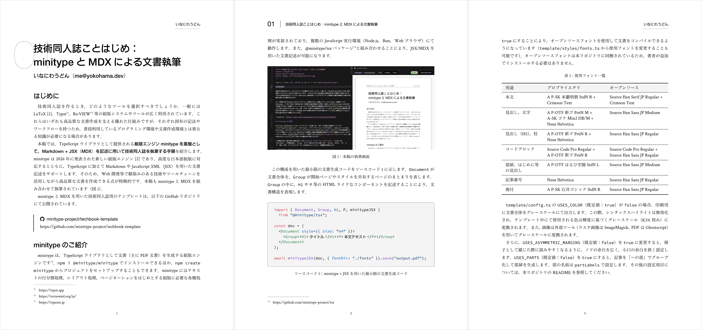

# techbook-template

組版エンジン [minitype](https://typeset.jp/) を用いて技術同人誌（B5 判，横組み）を制作するためのテンプレートです．
Markdown + JSX（MDX）を用いて記事を執筆します．



本テンプレートは，以下の特徴を有します．

- **Markdown + JSX による執筆**<br />
  本文を Markdown で手軽に記述しつつ，注記，コラム，複雑な表等，Markdown のみでは記述しにくい表現には JSX コンポーネントを利用できます．
- **高品質な日本語組版**<br />
  高度な日本語組版に対応した minitype を使用して，高品質に組版された PDF を生成できます．
- **複数著者による制作に対応**<br />
  記事ごとにディレクトリを分けて執筆できます．誌面のスタイルは一元管理されるため，各著者がレイアウトを調整する必要はありません．目次や扉も自動で生成されます．
- **快適な執筆環境**<br />
  執筆中の誌面のリアルタイムプレビュー，コードブロックの自動フォーマット，豆腐文字の検出，オープンソースフォントを用いたコンパイル等にも対応しています．
- **印刷・入稿に便利な機能**<br />
  印刷用のグレースケール変換，ノド・小口の余白調整，塗り足し付きの扉の生成，PDF の差分検査等が行えます．
- **すぐに利用可能**<br />
  Node.js の環境があればすぐに執筆を開始できます．

テンプレートの仕組みや記法に関しては，[サンプル記事](./articles/sample/index.mdx)（PDF：[dist/sample.pdf](./dist/sample.pdf)）で解説しています．

## クイックスタート

Node.js がインストールされている環境で，以下のコマンドを実行してください．

```bash
# テンプレートの取得
git clone https://github.com/minitype-project/techbook-template.git
cd techbook-template

# 依存関係のインストール
npm i

# サンプル記事のプレビュー
npm run dev sample
```

表示された URL（<http://localhost:5173>）をブラウザで開くと，サンプル記事をプレビューできます．

自分の記事を執筆するには，`articles/sample/` を `articles/<dirname>/` にコピーして，`index.mdx` を編集してください（詳細は[記事の執筆](#記事の執筆)を参照）．

```bash
# 単体記事をコンパイルして dist/<dirname>.pdf を生成
npm run build <dirname>
# 書籍全体をコンパイルして dist/book-<YYYYMMDD>-<HHMMSS>.pdf を生成
npm run build
```

書籍全体の設定や記事の掲載順は `template/config.ts` で変更できます（詳細は[設定](#設定)を参照）．

## 外部ツールのインストール

モノクロ出力時の画像のグレースケール変換（`USES_COLOR = false`）および PDF の差分検査（`npm run diff`）には，外部ツールのインストールが必要です．

```bash
# 外部ツールのインストール
## macOS
brew install imagemagick ghostscript poppler
## Linux
sudo apt install imagemagick ghostscript poppler-utils
## Windows
winget install ImageMagick.Q16-HDRI
winget install ArtifexSoftware.GhostScript
winget install oschwartz10612.Poppler
```

- ImageMagick は 7 系（`magick` コマンド）が必要です．Linux のパッケージマネージャで 6 系しか提供されていない場合は，[公式サイト](https://imagemagick.org/script/download.php)の AppImage 等を用いてください．
- Windows では，各外部ツールの実行ファイルが配置されたディレクトリが環境変数 `PATH` に含まれていない場合は，追加してください．

## 文書のコンパイル

```bash
# 開発サーバを起動して記事をリアルタイムプレビュー
npm run dev <dirname>
# 書籍全体をコンパイルして dist/book-<YYYYMMDD>-<HHMMSS>.pdf を生成
npm run build
# 単体記事をコンパイルして dist/<dirname>.pdf を生成
npm run build <dirname>
# 全記事を個別にコンパイルして dist/<dirname>.pdf を生成
npm run build:all
# 目次のみをコンパイルして dist/toc.pdf を生成
npm run build:toc
# 扉のみをコンパイルして dist/tobira.pdf を生成
npm run build:tobira
# 各辺 3 mm の塗り足し付きの扉を dist/tobira-padding.pdf に生成
npm run build:tobira-padding
```

`npm run build`（目次 + 全記事）に記事を含めるには，`template/config.ts` の `articleOrder` に記事のディレクトリ名を追加してください．

## 記事の執筆

- `articles/` にディレクトリを作成して，その中の `index.mdx` に記事を執筆してください．
  - ブランチを切って，PR として提出されることを推奨します．
- サンプル記事（`articles/sample`）を書き方の参考にしてください．
- MDX の先頭に YAML フロントマターとして以下の内容を記述してください．各項目の詳細はサンプル記事を参照してください．
  ```yaml
  ---
  title: 本文の\n記事タイトル（必須）
  title-toc: 目次の\n記事タイトル（任意）
  title-tobira: 扉の\n記事タイトル（任意）
  author: 著者名（必須）
  author-detail: 著者詳細．メールアドレス，所属，SNS アカウント等（任意）
  author-image: profile.jpg # 著者紹介欄の画像のパス．JPEG または PNG（任意）
  auto-format: true # コードブロックに自動フォーマットを適用するかどうか（任意，既定値：true）
  heading-top-space: 4 # 記事タイトル上部の余白（mm）．負の値で上に詰める（任意，既定値：4）
  ---
  ```
- 記事末尾には著者紹介として，著者近影 + 自己紹介を含めることができます．
- チェックリストとして [docs/checklist.md](./docs/checklist.md) を添付しています．よろしければ参考にしてください．

## 設定

`template/config.ts` で以下の項目を設定できます．

| 項目 | 説明 |
| --- | --- |
| `articleOrder` | 書籍に含める記事のディレクトリ名と掲載順． |
| `partLabels` | 部の名前（`USES_PARTS` が true のときに部扉・目次に表示）．空文字列の部は部扉と目次の部見出しを省略する． |
| `USES_PARTS` | 記事を「〜の部」でグループ化するかどうか（既定値：false）． |
| `USES_OSS_FONTS` | プロプライエタリフォントの代わりにオープンソースフォントを使用するかどうか（既定値：true）． |
| `USES_COLOR` | 文書をカラーで出力するかどうか．false のとき，印刷用にグレースケール（K5% 刻み）で出力するとともに，画像をグレースケールに変換する（既定値：true）． |
| `USES_ASYMMETRIC_MARGINS` | ノドの余白を広く，小口の余白を狭く設定するかどうか（既定値：false）． |
| `HONTOBIRA_PDF` | 本扉の PDF のパス（プロジェクトルートからの相対パス）．書籍全体のビルドで 1 ページ目に全面配置する．null のときには本扉を設けず，1 ページ目から目次を開始する（既定値：`"cover/hontobira.pdf"`）． |
| `bookMetadata` | PDF メタデータに設定する書籍名，発行者名． |

### フォント

本番用データのコンパイルには，以下のフォントが PC にインストールされている必要があります．

- A P-SK 本蘭明朝 StdN R（写研）
- A-SK ゴナ Min2 DB/M（写研）
- A P-SK 石井ゴシック StdN R（写研）
- A P-OTF 新ゴ Pr6N M/R（モリサワ）
- A P-OTF はるひ学園 StdN L（モリサワ）
- Neue Helvetica（Monotype）

これらのフォントを用意できない場合，`USES_OSS_FONTS` を `true` にすることで，オープンソースフォントを利用して記事をコンパイルできます．
オープンソースフォントはリポジトリに同梱されているため，追加でのインストールは不要です．

## 入稿用データ作成，データチェック

電子版・入稿用データの作り方は [docs/data.md](./docs/data.md) を参照してください．

また，以下のコマンドにより，コンパイルされた PDF の差分（ページ数，しおり，抽出されたテキスト，見た目）を検出することができます．

```bash
# 引数を省略した場合は dist/book-*.pdf のうち新しい 2 つを比較し，差分画像を dist/diff-<old>-<new>/ に出力
npm run diff [old.pdf] [new.pdf]
```

## ライセンス

Copyright (c) 2026 Yuto Wada. This software is released under the MIT License, see [LICENSE](./LICENSE).

`fonts/` 配下のフォントに関しては，[SIL Open Font License 1.1](https://openfontlicense.org/) の下で再配布しています．
詳細なライセンスに関しては，`fonts/LICENSE-*.txt` を参照してください．

本テンプレートが依存する組版エンジン [minitype](https://www.npmjs.com/package/@minitype/minitype) は [PolyForm Noncommercial License 1.0.0](https://polyformproject.org/licenses/noncommercial/1.0.0/) の下で提供されていますが，個人またはサークルによる同人活動を目的とした利用であれば，成果物の頒布が無償・有償のいずれであっても，本テンプレートおよび minitype を無条件に使用できます．

本テンプレートは [驚額の殿堂 技術同人誌『フランクフルト』Vol. 2](https://kyogaku-dendo.booth.pm/items/9039924) の発行に向けて整備されました．
テンプレートの整備に際してご協力いただいたみなさまに感謝いたします．
