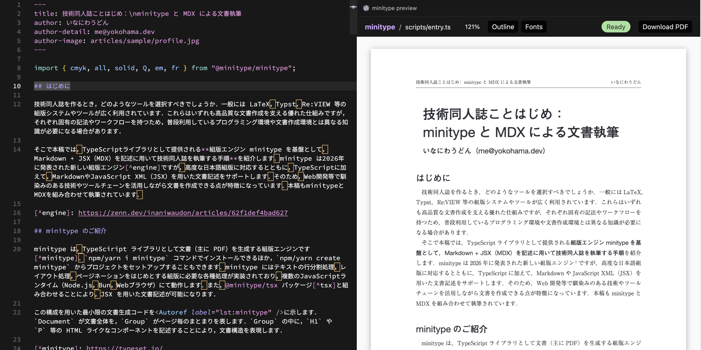

import { cmyk, all, solid, Q, em, fr } from "@minitype/minitype";
import { Cite, Bibliography } from "./bibliography.js";

## はじめに

技術同人誌を作るとき，どのようなツールを選択すべきでしょうか．
一般には LaTeX<Cite keys="lamport1994" />，Typst[^typst]，Re:VIEW[^review] 等の組版システムやツールが広く利用されています．
これらはいずれも高品質な文書作成を支える優れた仕組みですが，それぞれ固有の記法やワークフローを持つため，普段利用しているプログラミング環境や文書作成環境とは異なる知識が必要になる場合があります．

本稿では，TypeScript ライブラリとして提供される**組版エンジン minitype を基盤として，Markdown + JSX（MDX）を記述に用いて技術同人誌を執筆する手順**を紹介します．
minitype は 2026 年に発表された新しい組版エンジン<Cite keys="minitype2026" />であり，高度な日本語組版に対応するとともに，TypeScript に加えて Markdown や JavaScript XML（JSX）を用いた文書記述をサポートします．
そのため，Web 開発等で馴染みのある技術やツールチェーンを活用しながら高品質な文書を作成できる点が特徴的です．
本稿も minitype と MDX を組み合わせて執筆されています（<Autoref label="fig:writing" />）．

minitype と MDX を用いた技術同人誌用のテンプレートは，以下の GitHub リポジトリにて公開されています．

<GitHub org="minitype-project" repo="techbook-template" />

## minitype のご紹介

minitype は，TypeScript ライブラリとして文書（主に PDF 文書）を生成する組版エンジンです[^minitype]．
`npm i @minitype/minitype` でインストールできるほか，`npm create minitype` からプロジェクトをセットアップすることもできます．
minitype にはテキストの行分割処理，レイアウト処理，ページネーションをはじめとする組版に必要な各種処理が実装されており，複数の JavaScript実行環境（Node.js，Bun，Web ブラウザ）にて動作します．
また，@minitype/tsx パッケージ[^tsx]と組み合わせることにより，JSX/MDX を用いた文書記述が可能になります．

[^typst]: https://typst.app
[^review]: https://reviewml.org/ja/
[^minitype]: https://typeset.jp



この構成を用いた最小限の文書生成コードを<Autoref label="lst:minitype" />に示します．
`Document` が文書全体を，`Group` が開始ページやスタイルを共有するページのまとまりを表します．
`Group` の中に，`H1` や `P` 等の HTML ライクなコンポーネントを記述することにより，文書構造を表現します．

[^tsx]: https://github.com/minitype-project/tsx

```tsx:minitype + JSX を用いた最小限の文書生成コード#lst:minitype
import { Document, Group, H1, P, minitypeJSX }
  from "@minitype/tsx";

const doc = (
  <Document style={{ size: "A4" }}>
    <Group><H1>タイトル</H1><P>本文テキスト</P></Group>
  </Document>
);

await minitypeJSX(doc, { fontDir: "./fonts" }).save("output.pdf");
```

## 本リポジトリのアーキテクチャ

本リポジトリは，複数の著者が共同で 1 冊の技術同人誌を執筆するための環境を提供します．
本リポジトリでは主に以下の JavaScript パッケージを使用しています．

- @minitype/minitype：組版エンジン
- @minitype/tsx：minitype の JSX/MDX サポート
- @minitype/vite-plugin：リアルタイムプレビュー用の Vite プラグイン
- @biomejs/biome：コードチェッカー
- @biomejs/js-api：コードブロックの自動フォーマット

主に編集することになるファイル群を<Autoref label="lst:techbook-template" />に示します．

```:本リポジトリのディレクトリ構成#lst:techbook-template
techbook-template/
├── articles/
│   └── <dirname>/          # 記事毎のディレクトリ
│       ├── components.tsx  # 記事固有のコンポーネント（任意）
│       ├── profile.jpg     # プロフィール画像
│       └── index.mdx       # 記事本文（MDX 形式）
├── dist/                   # コンパイルされた PDF 文書の出力先
└── template/
    ├── components.tsx      # 共通コンポーネント
    ├── config.ts           # 設定ファイル
    ├── index.tsx           # 組版ロジック
    ├── styles/             # スタイル，フォント，色
    └── utils/              # コードフォーマット等の補助処理
```

各記事の著者は，`npm i` コマンドを実行して上記パッケージをインストールした後，`articles/` 配下にディレクトリを作成して，`index.mdx` に記事を執筆します．
スタイルや組版設定は `template/` 配下のファイルにて一元管理されているため，著者は Markdown（+ JSX）の記述のみに集中できます[^separation]．

[^separation]: スタイルと内容の分離は CSS と HTML の関係に類似しています．著者がスタイルを意識せずに書けることは，文書の体裁を統一するという観点からも重要であると考えています．

### 文書のコンパイル

記事執筆時には，<Autoref label="lst:build" />のコマンドを用いて各記事をコンパイルして PDF 文書を生成したり，リアルタイムプレビュー用の開発サーバを起動したりすることができます．
開発サーバ上ではリアルタイムプレビュー用ページが起動するため，著者は当該ページをエディタ内のブラウザ等で表示することにより，仕上がりを確認しながら文書を執筆できます[^dev]．

なお，使用フォントに含まれない文字（いわゆる豆腐文字）が文書中に含まれる場合，コンパイルはエラーとなって失敗します（開発サーバではプレビューにエラーが表示されます）．
エラーメッセージに該当する文字が表示されるため，別の文字に置き換えるか，フォントを追加してください．

[^dev]: 開発サーバを起動すると，`dist/<dirname>.pdf` も自動更新されます．

```bash:記事のコンパイルコマンド#lst:build
# 単体記事をコンパイルして dist/<dirname>.pdf を生成
npm run build <dirname>
# 全記事を個別にコンパイルして dist/<dirname>.pdf を生成
npm run build:all
# 開発サーバを起動して記事をリアルタイムプレビュー
npm run dev <dirname>
```

目次 + 全記事をまとめた書籍全体をコンパイルするには，<Autoref label="lst:build-all" />のコマンドを実行します．
このコンパイルに含めるためには，`template/config.ts` の `articleOrder`（部ごとに `type` と `articles` を持つオブジェクトの配列）の，いずれかの部の `articles` に `<dirname>` を追加する必要があります．

```bash:目次 + 全記事のコンパイルコマンド#lst:build-all
# 書籍全体をコンパイルして dist/book-<YYYYMMDD>-<HHMMSS>.pdf を生成
npm run build
```

この他に，目次や扉のみをコンパイルするコマンドや，2 つの PDF の差分（ページ数，しおり，抽出されたテキスト，見た目）を検査する `npm run diff` コマンドも用意されています．
コマンドの一覧については本リポジトリの README を参照してください．

### フォントと設定

本リポジトリが提供するテンプレートが使用するフォントを<Autoref label="tab:fonts" />に示します．
本テンプレートではプロプライエタリなフォントを使用していますが，各著者がそれらのフォントを用意できるとは限りません．
そこで，`template/config.ts` の `USES_OSS_FONTS` を `true` にすることにより，オープンソースフォントを使用して文書をコンパイルできるようになっています（`template/styles/fonts.ts` から使用フォントを変更することも可能です）．
オープンソースフォントは本リポジトリに同梱されているため，著者が追加でインストールする必要はありません．

<Easytable
  caption="使用フォント一覧"
  label="tab:fonts"
  style={{ columnWidths: [fr(2), fr(3), fr(3)] }}
>
  <Tr>
    <Td>用途</Td>
    <Td>プロプライエタリ</Td>
    <Td>オープンソース</Td>
  </Tr>
  <Tr>
    <Td>本文</Td>
    <Td>A P-SK 本蘭明朝 StdN R +<Br />Crimson Text</Td>
    <Td>Source Han Serif JP Regular +<Br />Crimson Text</Td>
  </Tr>
  <Tr>
    <Td>見出し，太字</Td>
    <Td>A P-OTF 新ゴ Pr6N M +<Br />A-SK ゴナ Min2 DB/M +<Br />Neue Helvetica</Td>
    <Td>Source Han Sans JP Medium</Td>
  </Tr>
  <Tr>
    <Td>見出し（H5），柱</Td>
    <Td>A P-OTF 新ゴ Pr6N R +<Br />Neue Helvetica</Td>
    <Td>Source Han Sans JP Regular</Td>
  </Tr>
  <Tr>
    <Td>コードブロック</Td>
    <Td>Source Code Pro Regular +<Br />A P-OTF 新ゴ Pr6N R</Td>
    <Td>Source Code Pro Regular +<Br />Source Han Sans JP Regular</Td>
  </Tr>
  <Tr>
    <Td>部扉，はじめに等の見出し</Td>
    <Td>A P-OTF はるひ学園 StdN L</Td>
    <Td>Source Han Sans JP Medium</Td>
  </Tr>
  <Tr>
    <Td>記事番号</Td>
    <Td>Neue Helvetica</Td>
    <Td>Source Han Sans JP Regular</Td>
  </Tr>
  <Tr>
    <Td>奥付</Td>
    <Td>A P-SK 石井ゴシック StdN R</Td>
    <Td>Source Han Sans JP Regular</Td>
  </Tr>
</Easytable>

`template/config.ts` の `USES_COLOR`（既定値：`true`）が `false` の場合，印刷用に文書全体をグレースケールにて出力します．
この際，シンタックスハイライトは無効化され，テンプレート中にて使用される色は輝度に基づくグレースケール（K5% 刻み）に変換されます．
また，画像は外部ツール（ラスタ画像は ImageMagick，PDF は Ghostscript）を用いてグレースケールに変換されます．

さらに，`USES_ASYMMETRIC_MARGINS`（既定値：`false`）を `true` に変更すると，冊子として綴じた際に読みやすくなるように，ノドの余白を広く，小口の余白を狭く設定します．
`USES_PARTS`（既定値：`false`）を `true` にすると，記事を「〜の部」でグループ化して部扉を生成します．
部の名前は `partLabels` で設定します．
その他の設定項目については，本リポジトリの README を参照してください．

## 記事を執筆する

次の手順で記事の作成，執筆，および確認を行います．
ここでは，作成する記事のディレクトリ名を `my-article` とします．

1. `articles/sample/` を `articles/my-article/` にコピーする．
2. コピー先の `index.mdx` を開き，先頭の YAML フロントマターにあるメタデータ（タイトル等）と本文を書き換える．
3. `npm run dev my-article` を用いてリアルタイムプレビューツールを起動するか，または `npm run build my-article` を実行して生成される `dist/my-article.pdf` を開いて，仕上がりを確認する．

### YAML フロントマター

MDX の先頭には，YAML フロントマターとして<Autoref label="lst:frontmatter" />の内容を記述します．

```yaml:YAML フロントマターの定義#lst:frontmatter
---
title: 本文の\n記事タイトル（必須）
title-toc: 目次の\n記事タイトル（任意）
title-tobira: 扉の\n記事タイトル（任意）
author: 著者名（必須）
author-detail: 著者詳細（任意）
author-image: 著者紹介欄の画像のパス（任意）
auto-format: コードブロックに自動フォーマットを適用するかどうか（任意，既定値：true）
heading-top-space: 記事タイトル上部の余白（mm）（任意，既定値：4）
---
```

各項目の詳細は以下の通りです．

- `title`，`author`：先頭ページおよび柱（ヘッダ）に表示されるタイトルと著者名を指定します．`title` 中の `\n` で本文見出しを改行します．柱では改行指定を取り除き，和文同士は連結，それ以外はスペースで区切ります．
- `title-toc`，`title-tobira`：目次および扉に表示されるタイトルを指定します．`\n` で改行します．省略時は `title` の改行指定を取り除いて使用します．
- `author-detail`：著者詳細（メールアドレス，所属，SNS アカウント等）を指定します．先頭ページおよび記事末尾の著者紹介欄に表示されます．

<NewPage />

- `author-image`：著者紹介欄に表示されるアイコン画像のパスを指定します．記事ディレクトリからの相対パスで指定します．省略した場合はグレーの矩形が表示されます．
- `auto-format`：コードブロックの自動フォーマットを制御します．デフォルトでは，コードブロックの内容は Biome（@biomejs/js-api）を用いてコンパイル時に自動フォーマットされて出力されます．フォーマット対象の言語には，`ts`，`tsx`，`js`，`jsx`，`json`，`css`，`graphql` 等が含まれます．`sh`，`yaml`，`md` 等，Biome が対応していない言語のコードブロックはそのまま出力されます．明示的に `auto-format: false` を指定した場合，記事内のすべてのコードブロックに対してフォーマットを適用しません．
- `heading-top-space`：先頭ページの記事タイトル上部の余白を mm 単位で指定します．負の値を指定するとタイトルを上に詰めることができます．

### Markdown 記法

本文は通常の Markdown を用いて記述できます[^space]．
見出し，箇条書き，図表，コードブロック，脚注，**太字**，インラインコード（`code`），~~打ち消し線~~，数式 $E=mc^2$，コメント等，ひと通りの記法はサポートされています（少なくとも本稿に登場する程度であれば記述が可能です）[^italic]．
<Autoref label="lst:markdown" />に記述例を示します．

[^space]: 和欧間（日本語–英数字間）のスペースは，挿入した場合も挿入していない場合も同一に処理されます．こうした処理は組版処理系に任せるべき事項です．
[^italic]: 斜体は日本語組版では一般的でないため，本テンプレートではサポートされていません．

````md:Markdown 記法の例#lst:markdown
## 中見出し

### 小見出し

**太字**や`inline-code` が使用できます．
改行を挟んだ場合も，そのまま段落として継続されます．
In English text, a space is inserted between sentences. Therefore, there is no need to insert an additional space.

<Br />を挿入すると改行されます（前行を左揃えにして次の行へ送る）．
<Fbr />を挿入すると強制改行されます（前行を両端揃えにして次の行へ送る）．

空行を入れると改段落になります[^fn]．数式 $E=mc^2$ や~~打ち消し線~~も挿入できます．

$$
\int_0^1 x \, dx = \frac{1}{2}
$$

[^fn]: このように脚注も挿入できます．

{/* コメント */}

- 通常の箇条書き（レベル 1）
  - 通常の箇条書き（レベル 2）

1. 番号付き箇条書き
2. 番号付き箇条書き


[リンクテキスト](https://example.com)
https://example.com

| 見出し 1 | 見出し 2 |
|---|---|
| 本文 1 | 本文 2 |

```ts
// コードブロック
console.log("Hello World!");
```

> 引用文
````

{/* コメントの確認用に挿入 */}

これらの要素は minitype のブロック／インライン要素へ変換され，`template/index.tsx` にてスタイルが適用されます．
この際に，中見出しおよび小見出しは，版面下部に孤立して配置されないように自動調整されます[^heading-bottom]．

また，MDX の評価前には，本文に対して以下の変換が自動で適用されます．
コードブロックおよびインラインコードの内部，JSX のタグおよび属性値，ならびにリンクの URL は変換対象外です．

- 対になったストレートクォート（`"..."`）はスマートクォート（“...”）に変換されます．
- 英単語内のアポストロフィ（例：`don't` の `'`）は右シングルクォート（’）に変換されます．

<NewPage />

- 半角丸括弧は，前後の半角スペースを取り除いた上で全角丸括弧に変換（例：`foo (bar) baz` → `foo（bar）baz`）されます．ただし，`foo()` のように英数字の直後に続き，括弧内に和文を含まないものは変換されません．
- 生の URL は自動でリンクに変換されます．

#### コードブロック

コードブロックには，以下のオプションが存在します．

- 言語名を指定する（例：`` ```ts ``）と，シンタックスハイライトが適用されます．
- コードブロックの言語に続けて `:caption` を記述する（例：`` ```ts:index.ts ``）と，コードブロックの下にキャプションが付与されます．
- 言語名を省略してキャプションのみを付与することもできます（例：`` ```:ディレクトリ構成 ``）．この場合，シンタックスハイライトおよび自動フォーマットは適用されません．
- キャプションの末尾に `#label` を付与すると，コードブロックにラベルを設定できます（例：`` ```ts:index.ts#lst:example `` → `index.ts` というキャプションおよび `lst:example` というラベルを付与）．
- キャプションの末尾に `@t`，`@b` を付与すると，それぞれ版面上部，下部にフロートとして固定配置します．

[^heading-bottom]: 厳密には，見出しが版面下部よりも 8 mm 以上上に位置するように指定されています．

#### 図版

図版（画像）として，PNG，JPEG，SVG，PDF 形式を挿入できます．また，以下のオプションが存在します．

- alt テキストを指定するとキャプション付きの図版（`Figure`）として（<Autoref label="fig:cherry" />），alt テキストを空にするとキャプションなしの画像（`Image`）として配置されます．
- alt テキストの末尾に `#label` を付与すると，図版にラベルを付与します．
- alt テキストの末尾に `@t`，`@b` を付与すると，それぞれ版面上部，下部にフロートとして固定配置します．
- `src` の末尾に `?ratio=` クエリパラメータを付与する（例：``）と，本文幅に対する比率を指定できます（既定値：`1.0`，<Autoref label="fig:cherry-ratio" />）．


#### 表

表には，以下のオプションが存在します．

<NewPage />
<Addvspace space={-2} />

- 表の直前の行に斜体（`*キャプション*`）を記述すると，表のキャプションとして挿入されます．
- キャプションの末尾に `#label` を付与すると，表にラベルを付与できます．
- キャプションの末尾に `@t`，`@b` を付与すると，それぞれ版面上部，下部にフロートとして固定配置します．
- ただし，Markdown で挿入した表は詳細なカスタマイズ（列幅の調整等）に対応していないため，<Autoref label="lst:easytable" />に示す `Easytable` コンポーネントを使用することを推奨します（<Autoref label="tab:easytable" />）．


<Easytable
  caption="Easytable コンポーネントの出力例"
  label="tab:easytable"
  style={{ columnWidths: [fr(2), fr(4), fr(4)] }}
>
  <Tr>
    <Td>観点</Td>
    <Td>LaTeX</Td>
    <Td>minitype</Td>
  </Tr>
  <Tr>
    <Td>記述方法</Td>
    <Td>TeX 言語のコマンドやマクロ．</Td>
    <Td>TypeScript / JSX / MDX 等．</Td>
  </Tr>
  <Tr>
    <Td>日本語組版</Td>
    <Td>pLaTeX や LuaLaTeX を利用することにより，高度な日本語組版が可能．</Td>
    <Td>禁則処理，縦組，ルビ，段組，文字組アキ量設定等の日本語組版機能を備える．</Td>
  </Tr>
  <Tr>
    <Td>数式</Td>
    <Td>数式組版に非常に強く，学術論文等で広く利用される．</Td>
    <Td>MathJax がレンダリングした数式を挿入可能．</Td>
  </Tr>
</Easytable>


````md:Easytable コンポーネントの例#lst:easytable
<Easytable
  caption="Easytable コンポーネントの出力例"
  label="tab:easytable"
  style={{ columnWidths: [fr(2), fr(4), fr(4)] }}
>
  <Tr>
    <Td>観点</Td>
    <Td>LaTeX</Td>
    <Td>minitype</Td>
  </Tr>
  <Tr>
    <Td>記述方法</Td>
    <Td>TeX 言語のコマンドやマクロ</Td>
    <Td>TypeScript / JSX / MDX 等</Td>
  </Tr>
</Easytable>
````


#### 引用ブロック

引用ブロックの左側には罫線が表示されます．

> こんな夢を見た。
>
> 腕組をして枕元に坐っていると、仰向に寝た女が、静かな声でもう死にますと云う。女は長い髪を枕に敷いて、輪郭の柔らかな瓜実顔をその中に横たえている。真白な頬の底に温かい血の色がほどよく差して、唇の色は無論赤い。とうてい死にそうには見えない。しかし女は静かな声で、もう死にますと判然云った。……（夏目漱石「夢十夜」）

### JSX コンポーネントとの併用

MDX の強みは，Markdown の中に JSX コンポーネントを埋め込める点にあります．
これにより，Markdown では表現が難しい特殊な図表や minitype 固有のレイアウト要素を，記事中に直接挿入することができます．

#### テンプレート独自のコンポーネント

本テンプレートでは，`Note`，`Warning`，`Important`，`Tips` コンポーネントにて，色付きの Notation ブロックを提供しています（<Autoref label="lst:notation" />）．
これらはテンプレート側にて自動でインポートされるため，MDX からこれらを明示的にインポートする必要はありません．

<NewPage />

```tsx:Notation ブロックの例#lst:notation
<Note>
補足情報や参考リンクを記述するための青色のブロックです．
</Note>

<Warning>
注意が必要な事項を記述するための赤色のブロックです．
</Warning>

<Important>
特に重要な事項を記述するための黄色のブロックです．
</Important>

<Tips>
役立つ情報や活用例を記述するための緑色のブロックです．
</Tips>
```

<Note>
補足情報や参考リンクを記述するための青色のブロックです．
</Note>

<Warning>
注意が必要な事項を記述するための赤色のブロックです．
</Warning>

<Important>
特に重要な事項を記述するための黄色のブロックです．
</Important>

<Tips>
役立つ情報や活用例を記述するための緑色のブロックです．
</Tips>

この他に，本テンプレートでは<Autoref label="lst:template-components" />に示すコンポーネントを提供しています．
これらは `template/components.tsx` にて定義されています．

```tsx:テンプレート独自のコンポーネントの例#lst:template-components
<Column title="コラムのタイトル">
  本文とは独立した話題を記述するためのコラムです．
</Column>

<H5>小見出しよりも下位の見出し</H5>

<GitHub org="minitype-project" repo="techbook-template" />

<AuthorProfile>
  著者紹介文．
</AuthorProfile>
```

- `Column`：タイトル付きの枠で囲まれたコラムを挿入します．ページをまたいで分割できます．
- `H5`：Markdown の見出し（`####` まで）よりも下位の見出しを挿入します．
- `GitHub`：GitHub のアイコンとともに，`org`，`repo` 属性で指定したリポジトリ名および URL を表示します．
- `AuthorProfile`：記事末尾に著者紹介欄を挿入します．著者名と画像は，既定ではフロントマターの `author`，`author-image` が使用されます．上書きする場合には，`name`，`image` 属性を指定します．

また，記事ディレクトリに `components.tsx`（または `components.ts`）を配置すると，そこでエクスポートしたコンポーネントが自動で読み込まれ，その記事の MDX からインポートなしに使用できます．
記事固有のコンポーネントを定義したい場合に利用してください．

#### @minitype/tsx が提供するコンポーネント

@minitype/tsx では minitype 固有の機能を使用するためのコンポーネントを提供しています（<Autoref label="lst:jsx1" />）．
これらのコンポーネントも明示的なインポートは不要です（ただし，minitype の関数を使用する場合には `import ... from "@minitype/minitype"` が必要です）．

```md:JSX コンポーネントの例 1#lst:jsx1
<NewPage />
<ClearPage />
<Vspace space={8} />    {/* 要素間の垂直スペースを 8 mm に指定 */}
<Addvspace space={-4} /> {/* 要素間の垂直スペースを 4 mm 詰める */}
<Ruby ruby="ばら">薔薇</Ruby>が咲いた．
```

`Addvspace` や `NewPage` を使用することにより，要素の間を詰めたり，改ページを調整したりすることができます．

<NewPage />

- `Vspace` は，要素間の垂直方向のスペースを `space` 属性（mm）で上書きします．
- `Addvspace` はブロック間の既存の間隔（`gap`）に加えて，さらにスペースを挿入します．負の値を取ることもできます．
- `NewPage` はその箇所で改ページを行います．
- `ClearPage` は未出力のフロートを出力してから改ページを行います．

その他，代表的なコンポーネントを<Autoref label="lst:jsx2" />に示します．

```tsx:JSX コンポーネントの例 2#lst:jsx2
<Box style={{ border: all(solid(0.3, cmyk(0, 0, 0, 100))), padding: all(4) }}>
  枠で囲まれた段落．
</Box>

<Float position="top">
  <Figure src="./image.png" label="fig:sample3">図 1：キャプション</Figure>
</Float>

<Description>
  <Dt>minitype</Dt>
  <Dd>TypeScript ライブラリとして提供される組版エンジン．</Dd>
  <Dt>MDX</Dt>
  <Dd>Markdown の中に JSX を記述できる形式．</Dd>
</Description>

<Color value={cmyk(0, 80, 80, 0)}>赤いテキスト</Color>
<FontSize size={Q(10)}>小さいテキスト</FontSize>
<Scale factor={em(0.8)}>80% スケールのテキスト</Scale>
サンプル画像を<Autoref label="fig:sample3" />に示します．
```

- `Box`：ブロック要素を囲むコンテナです．枠線，背景色，パディング，角丸等のスタイルを自由に設定できます．コードブロックや Notation ブロックも `Box` コンポーネントを用いて実装されています．
- `Float`：版面上端（`"top"`）または版面下端（`"bottom"`）にブロックを固定配置します．本文とは独立して配置されるため，本文の流れを妨げることなく，図表やコラムボックスを配置することができます．
- `Ruby`：<Ruby ruby="ルビ">振り仮名</Ruby> を付与します．`ruby` 属性に読みを指定します．
- `Description`：`Dt`（見出し）と `Dd`（本文）を交互に並べる説明リストを示します．用語集や仕様一覧等，キーと説明を対応付けて列挙する用途に使用します．
- `Color`，`FontSize`，`Scale`：テキストに対して，<Color value={cmyk(0, 100, 0, 0)}>文字色</Color>，<FontSize size={Q(16)}>文字サイズ</FontSize>，<Scale factor={em(0.8)}>文字スケール（比率）</Scale>を適用します．`Color.value` には `cmyk()` や `rgb()` で生成した色を渡します．`FontSize.size` は mm 単位または `Q()` 等の関数を，`Scale.factor` は主に `em()` 関数を用いて指定します．
- `Autoref`：図版，表，およびソースコードのラベルを指定して，「図○」「表○」「ソースコード○」の形で参照します．

### 参考文献

本テンプレートでは，参考文献の管理と引用のために `createBibliography` 関数を提供します．
参考文献を指定する場合，記事ごとに `bibliography.tsx` を定義します（<Autoref label="lst:bibliography" />）．
`references` は，各文献にユニークなキー（例：`lamport1994`）を割り当てた連想配列です．
`type` には文献の種別（`article`，`inproceedings`，`book`，`masterthesis`，`phdthesis`，`webpage`，`misc`）を指定して，種別ごとに必要なフィールドを記述します．

```tsx:bibliography.tsx の記述例#lst:bibliography
import type { ReferenceRecord } from "@minitype/minitype";
import { createBibliography }
  from "../../template/bibliography.js";

const references: ReferenceRecord = {
  lamport1994: {
    type: "book",
    authors: ["Leslie Lamport"],
    title: "LaTeX: A Document Preparation System",
    year: 1994,
    publisher: "Addison-Wesley",
    address: "Reading, Massachusetts",
  },
  minitype2026: {
    type: "webpage",
    authors: ["いなにわうどん"],
    title: "TypeScript ライブラリとして動作する組版エンジン minitype を公開しました",
    year: 2026,
    url: "https://zenn.dev/inaniwaudon/articles/62f1def4bad627",
  },
};

export const { Cite, Bibliography } =
  createBibliography(references);
```

MDX では `bibliography.js` から `Cite` および `Bibliography` をインポートして，本文中にて `<Cite keys="..." />` を用いて文献を引用した上で，参考文献リストを表示したい箇所に `<Bibliography />` を配置します（<Autoref label="lst:cite" />）．
参考文献には出版年（発表年）を記載することを推奨しますが，これが不明な場合には，`year: 0` とすることで，表示を省略できます．

```md:参考文献の引用および一覧の表示#lst:cite
import { Cite, Bibliography } from "./bibliography.js";

LaTeX<Cite keys="lamport1994" /> は L. Lamport 氏によって開発されました．
minitype は 2026 年に発表されました<Cite keys="minitype2026" />．
複数の文献<Cite keys={["lamport1994", "minitype2026"]} />をまとめて引用することもできます．

## 参考文献
<Bibliography />
```

`Cite` の `keys` 属性には，単一のキー（文字列）または複数キーの配列を指定できます．
複数指定した場合は，`[1, 2]` のようにまとめて表示されます．
引用番号の直前には自動でノーブレークスペースが挿入されるため，直前の語との間での改行が防止されます（LaTeX における `~\cite{...}` に相当）．

## テンプレートをカスタマイズする

技術同人誌の組版担当者は，テンプレートをカスタマイズすることもできます．
テンプレートでは，`template/styles/style.ts` にて文書スタイルを定義した後，`template/index.tsx` にて MDX からの変換処理および組版処理を実行しています．

### スタイリング

版面の定義では，`calculatePhysicalPadding()` という関数を使用して，1 行あたりの文字数を指定して水平方向の余白を自動計算しています[^vertical]．
本テンプレートでは「1 行あたり全角 40 字分の本文幅」という制約を満たしつつ，ページサイズに合うように余白を設定しています．
また，minitype ではスタイルを `DocumentStyle` 型のオブジェクトとして定義します．
文字サイズ，行間，インデント等には `Q()` 関数（級数指定）[^q-unit]や `em()` 関数（文字サイズに対する相対指定）等を使用します．
詳細な仕様に関しては，minitype の公式ドキュメント[^minitype-doc]，@minitype/tsx のドキュメント，および @minitype/minitype の型定義ファイル（`*.d.ts`）を参照してください．

[^vertical]: 垂直方向の余白も計算可能ですが，本テンプレートでは使用していません．
[^q-unit]: 「級（Q）」は日本語組版における長さの単位で，1Q = 0.25 mm に相当します．
[^minitype-doc]: https://typeset.jp/references/

MDX の変換処理では，`createMdxComponents` が返す `pre` コンポーネントにコードブロックの変換処理を指定しています．
`Box` コンポーネントのスタイルを設定することで，枠線や背景色を調整することができます．

### 柱とノンブル

@minitype/tsx の `Flow` コンポーネントを使用すると，本文の流れとは独立したページ要素を配置できます．
本リポジトリのテンプレートでは，ページ上部にタイトルと著者名を表示する柱（`pillar`）と，ページ下部にページ番号を表示するノンブル（`nombre`）を設定しています．
ノンブルを設定するソースコード（`template/utils/nombre.tsx`）を<Autoref label="lst:nombre" />に示します．
`position="page"` を指定してページ全体を基準とし，ページ下端から 14 mm の位置にページ番号を配置しています．

```tsx:ノンブルの設定#lst:nombre
<Flow
  position="page"
  blockOffset={pageSizeMm.height - 14}
  inlineSize={pageSizeMm.width}
>
  <P style={{ size: Q(10), align: "center", firstIndent: 0 }}>
    <Page />
  </P>
</Flow>
```

もっとも，こうした処理のソースコードは，現代であれば Claude Code 等のコーディングエージェントを用いて記述することが可能なはずですので，臆することなくカスタマイズに挑戦していただければと思います[^customize]．

[^customize]: カスタマイズしたソースコードの公開ももちろん大歓迎です！

## まとめ

本稿では，minitype と MDX を組み合わせて技術同人誌を執筆する手順をご紹介しました．
これにより，Markdown で本文を執筆しつつ，必要に応じて JSX コンポーネントを用いて細かいレイアウトを制御することが可能となっています．

本稿で紹介したのはあくまで基本的な使用方法ですが，minitype 本体ではこの他にも，縦組，段組，フレックスボックス等の複雑なレイアウトに対応しています．
ぜひお好みのスタイルに合わせてテンプレートをカスタマイズして，快適な執筆環境を作り上げてみてください．

## 参考文献

<Bibliography />

<AuthorProfile>
筑波大学大学院システム情報工学研究群 M2．CS 専攻にもかかわらずヨガの授業を取ったりしてのんびりと過ごしています．<Br />
個人サイト：[https://いなにわうどん.みんな](https://いなにわうどん.みんな)
</AuthorProfile>
